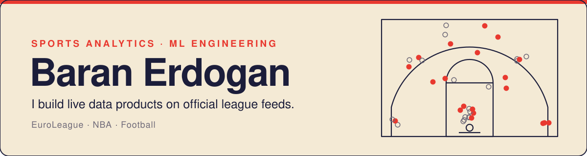
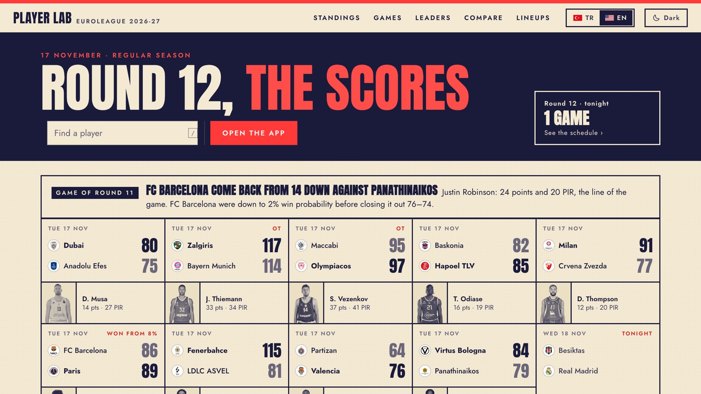
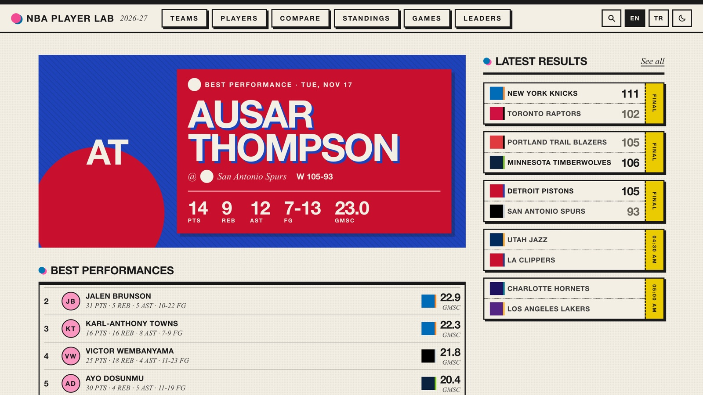
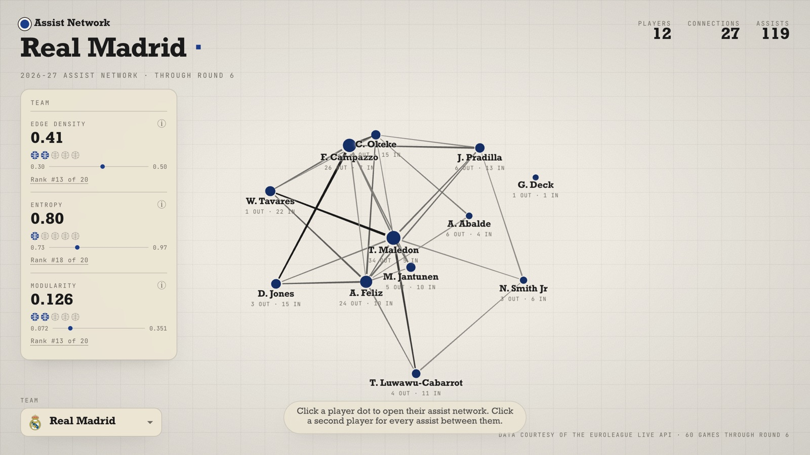
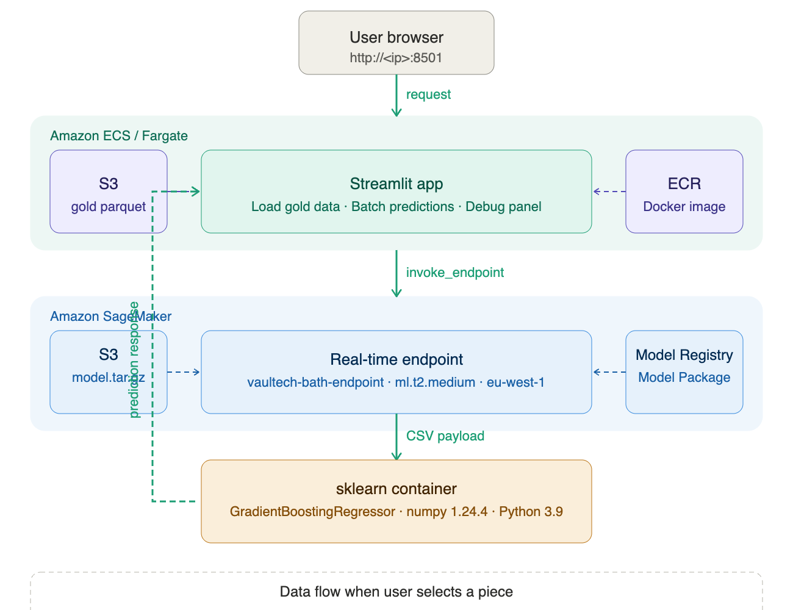
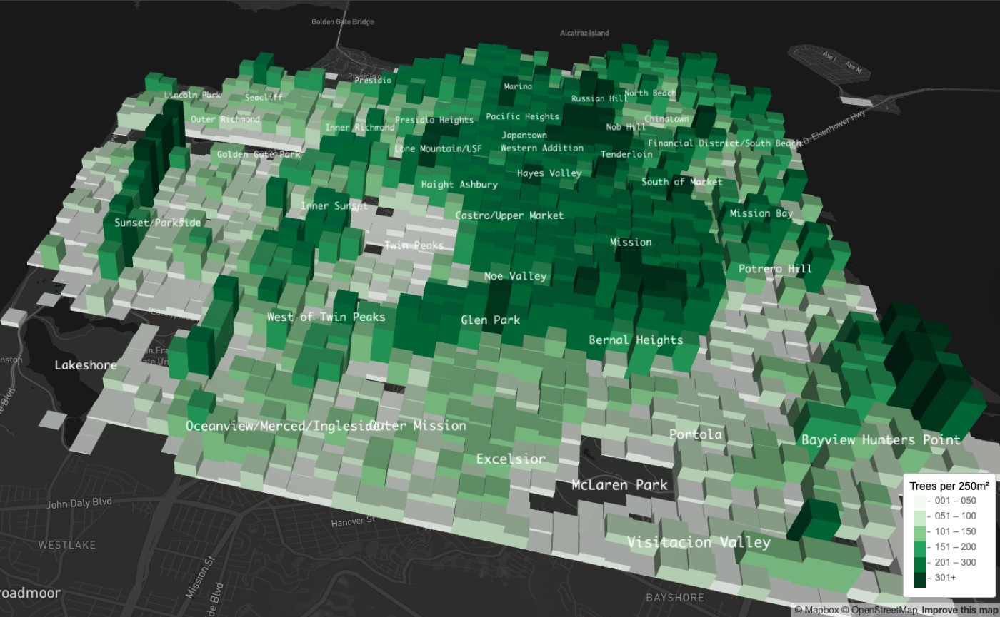

<picture>
  <source media="(prefers-color-scheme: dark)" srcset="header-dark.svg">
  
</picture>

I turn official league feeds into products people can open: tested pipelines, models that are validated against time, and front ends built to be read. MSc Business Analytics at ESADE, Industrial Engineering at Purdue, based in Barcelona. My coursework is here too.

**[elplayerlab.com](https://elplayerlab.com/)** · [LinkedIn](https://www.linkedin.com/in/baran-erdogan-34526921a/) · [Email](mailto:baran.erdogan@alumni.esade.edu)

## Featured

### [Euroleague Player Lab](https://elplayerlab.com/)

Stats, lineups, RAPM and animated 2D and 3D shot charts for every Euroleague player, rebuilt within about ten minutes of each final buzzer. A GitHub Actions pipeline loads a DuckDB and Parquet warehouse, 30 SQL assertions gate every build, and an expected-field-goal model scores every shot and is served as a FastAPI container.

[Live app](https://elplayerlab.com/) · [Code](https://github.com/baranerdogan11/Euroleague-Player-Lab)

<table>
<tr>
<td width="50%" valign="top">

**NBA Player Lab**

Player, team and lineup analytics for the 2026-27 NBA season, rebuilt from the official game feeds after every final. Play-by-play is reconciled with the box score before anything is published.

[Live app](https://baranerdogan11.github.io/NBA-Player-Lab/) · [Code](https://github.com/baranerdogan11/NBA-Player-Lab)
</td>
<td width="50%" valign="top">

**EuroLeague Assist Networks**

An interactive 3D graph of who assists whom at all 20 clubs, with density, entropy and modularity ranked across the league. Built with three.js on a Python pipeline.

[Live app](https://baranerdogan11.github.io/euroleague-assist-network/) · [Code](https://github.com/baranerdogan11/euroleague-assist-network)
</td>
</tr>
</table>

## Forecasting

- **[Euroleague 2026-27 Season Prediction](https://github.com/baranerdogan11/Euroleague-2026-27-Season-Prediction)**: an Elo-anchored XGBoost model on 1,848 games, roster-aware priors and 10,000 simulated seasons. Log loss 0.616 against 0.655 for the home-court base rate, validated season by season.
- **[World Cup 2026 Predictions](https://github.com/baranerdogan11/FIFA-WC-2026-Predictions)**: a match-outcome model on 29,990 internationals and 20,000 bracket simulations, frozen before the Round of 16. Both held-out ties were called correctly.

## MSc coursework at ESADE

<table>
<tr>
<td width="50%" valign="top">

**VaultTech: forging line cycle-time prediction**

A real industrial case on a steel forging line. From about 180k PLC readings, the model predicts a piece's quench-bath time 18 seconds into a 58-second cycle, with a mean error of 0.65 seconds on 25,990 held-out pieces. PostgreSQL medallion layers with Flyway migrations, a SageMaker real-time endpoint, and a Streamlit dashboard on Fargate.

[Code](https://github.com/baranerdogan11/baranerdogan-caws-final-project)
</td>
<td width="50%" valign="top">

**San Francisco Urban Forest**

A data portrait of 190,300 street trees and 561 species: density on a 3D Mapbox map, biodiversity by census tract, and 52 years of planting. Built in R as a four-panel interactive infographic. Group project.

[Code](https://github.com/baranerdogan11/dataviz-club)
</td>
</tr>
</table>

- **[Kickstarter success prediction](https://github.com/baranerdogan11/AI-II-Final-Project)**: six models on about 160k campaigns with chronological splits, using only pre-launch information. The models land within four AUC points of each other, so the features set the ceiling, not the algorithm.
- **[The Devil's Advocate](https://github.com/baranerdogan11/signability-checker-app)** (team project): three LLM agents debate each clause of a Spanish or Catalan rental contract, screened against 58 labeled reference clauses, and return a risk verdict.
- **[Eco-Smart grocery assistant](https://github.com/baranerdogan11/eco-smart-ai-final)**: an LLM reasons about implicit allergens and returns constrained JSON that drives a Streamlit dashboard, checked by a logistic-regression safety classifier.

## Stack

Python · SQL · R · DuckDB · PostgreSQL · XGBoost · scikit-learn · FastAPI · Docker · GitHub Actions · AWS SageMaker · three.js · D3

Turkish, English and Spanish.
